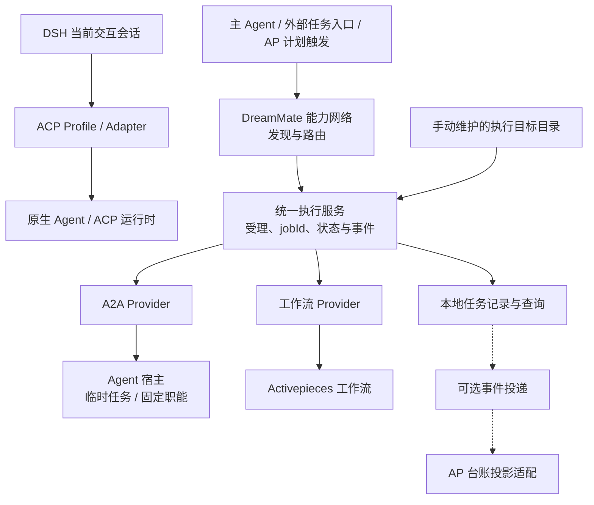

# ACP Service 统一执行服务、执行目标登记与任务台账改造方案

- 状态：设计草案，待实现与验收。
- 日期：2026-10-21（Asia/Shanghai）。
- 源码基线：`@1agents/acp-service 0.8.1`，提交 `db0ea6274a10b693eea937feef826d6391a6ba1d`。
- 本次交付：更新既有方案文档；不修改源码、依赖、工作流、部署配置或运行服务。下文新增目标目录、Provider 与接口均为拟议设计。
- 目标：手动登记通用 Agent 宿主、固定职能 Agent 和工作流，自动检查可用性；经统一执行入口受理的任务按 `jobId` 查询状态、轮次、结果、产物和关联流程运行。
- 本轮补充：统一父任务、子任务与执行轮次术语，明确状态归属、完成条件、角色闭环、验收版本、有界恢复和主会话通知边界；均为待实现设计，不代表当前部署已支持。

## 1. 设计决策

采用“手动登记执行目标、自动维护可用性、统一入口派单留痕、底层执行可替换”的方式。统一执行服务可由现有 A2A 网关逐步演化，无需立即拆出新仓库、发布包或独立进程。

登记的是能够接单的执行目标，不是每一次临时任务。目标分为通用 Agent 执行宿主、固定职能 Agent、工作流三类；人工配置为持久来源，探活结果与网络中的服务报备为运行视图。自动化只读取配置、辅助识别能力、探测及恢复连接，不静默新增、部署或删除执行目标。

ACP Profile 继续负责 DSH 当前交互会话与原生 Agent 的连接。统一执行服务负责被委托工作的受理、目标解析、`jobId`、执行轮次、查询和事件，再经 A2A 或工作流 Provider 派发。主 Agent 使用 ACP Profile 不等于已经创建一个业务任务。

统一执行服务保存业务任务、派发记录与已观察到的执行事实。Activepieces（下文简称 AP）可以分别承担计划触发、工作流执行后端、台账投影三种角色，配置与故障边界独立。AP 台账保存可重建投影及负责人、业务分类、验收结论等业务信息，不承担 Agent 执行状态的权威来源。

默认安装和使用 ACP Service 不要求 AP。仅启用 A2A 目标时无需 AP；调用 AP 工作流需要相应执行连接，但不要求同时启用 AP 台账。台账同步故障只影响同步，AP 执行后端故障只影响依赖该后端的工作；二者均不触发自动重复执行。

Session Reader 同样为可选集成：临时任务的 PWD 可手动填写，也可显式发起工作目录探查、手动选择后“一键导入”任务 cwd。未安装或不可用时保留手填能力，不阻塞 ACP、执行目标管理或派单；不作为服务包的强制运行依赖。

本方案覆盖经指定统一执行服务受理的任务，包括适配后的既有 A2A 与 automation 入口。直接调用执行端 `/a2a`、直接在 AP 中运行但未纳入该入口的流程，以及普通 ACP 交互会话，第一阶段不自动纳入。目标管理、能力查看和健康检查不创建业务任务。第一阶段不另建台账管理界面或数据库服务，也不新增 DAG、定时器或跨后端自动调度引擎。

减少主会话步骤采用“统一执行服务负责受理与留痕，领域角色服务负责交付闭环”的方式。PPT 的制作、文件校验、独立复核和有限返工属于可选角色服务，不放进通用台账的状态推断或调度规则；AP 可以承载该闭环，也可以由现有角色宿主实现，不成为新增必需依赖。

## 2. 现状与改造缺口

以下为源码现状，不代表当前部署状态；已有部署验收记录仅证明记录所覆盖的版本与路径。

| 项目 | 现有实现 | 本次拟补充 |
| --- | --- | --- |
| ACP 交互路径 | DSH 插件注册 ACP Adapter 与 Profile，A2A 挂载单独按配置启用 | 明确交互会话与被委托任务的职责，不强制所有会话进入任务台账 |
| 执行目标 | A2A 网关以 `remotes` 配置远端，派单指定 `cwd/agentPreset`；无三类统一目标目录 | 持久连接与目标配置、管理操作、能力声明和独立健康视图 |
| 普通派单 | `remote_agent_spawn/message` 保存到 `gateway.json.jobs`，以远端、来源会话和 `taskId` 关联 | 稳定业务 `jobId`、每轮 `attemptId`、派发前记录与业务关联 |
| 计划派单 | `/automation/runs` 记录发生项 `runId`，支持 `flowRunId/businessRef` | 发生项与通用任务关联，沿用已有计划去重规则 |
| 任务状态 | 查询及轮询远端 Task，离线返回 `stale` | 形成有版本的业务任务快照和已观察状态事件 |
| 完成通知 | 终态、需输入、需认证产生通知，保存 `noticeId`，支持投递与主会话确认 | 独立任务事件及订阅投递，不复用主会话通知确认 |
| AP 结果流 | 认领已登记计划批次的通知，保存报告后确认 | 新增通用台账投影流程，覆盖即时派单 |
| 模块依赖 | 无 AP SDK 运行依赖，`automation` 按配置启用；AP Piece 位于示例目录 | 保持可选边界，AP 表结构与连接逻辑留在适配侧 |
| 执行后端 | `A2ABackend` 面向文本提示、DSH 会话与单轮结果；现有 AP 流程用于触发 A2A 派单和处理结果 | 在其上新增面向任务的 Provider 合同；AP 工作流执行 Provider 不冒充现有 A2ABackend |

现有 AP 结果认领接口会寻找对应的 automation run。普通任务没有该记录，直接发送到现有结果流不足以完成通用留痕接入。现有计划任务说明见 [Activepieces 自动化](activepieces-automation.md)。

## 3. 模块边界

### 3.1 两条调用路径



| 层次 | 负责内容 | 边界 |
| --- | --- | --- |
| ACP Profile / Adapter | 为 DSH 当前会话选择并连接原生 Agent，转换交互、权限与会话消息 | 不负责目标目录、跨服务派单或统一业务台账；切换 Profile 不创建业务任务 |
| ACP 运行时与 A2A 执行宿主 | 原生 Agent 会话、实际执行、A2A Task 生命周期 | 不引入 AP 台账字段或工作流规则；固定职能也可使用非 ACP 的 DSH Profile |
| 执行目标管理 | 持久连接与目标配置、启停、能力校验、自动探活与诊断 | 不根据健康检查执行任务，不以失联为由删除人工配置 |
| 统一执行服务 | 任务、执行轮次、请求关联、目标版本快照、Provider 路由、查询与事件 | 不复制 Agent 执行或 AP 内部编排，不新增跨后端工作流引擎 |
| A2A / 工作流 Provider | 验证后端输入，提交任务，解释受理、状态和结果，按声明支持取消或继续 | 不伪造不支持的能力；不将工作流包装成文本会话来满足 A2ABackend |
| DreamMate Node | 报备、发现和路由统一执行服务及其公开契约 | 不成为任务权威存储或目标配置所有者，不自动承担任务调度 |
| 通用事件投递 | 持久事件、目的地回执、退避重试、同步诊断 | 不感知 AP 表名、字段 ID、Flow ID 或业务审批规则 |
| AP 台账投影适配 | Webhook 接入、任务表投影、字段映射、Flow Run 关联 | 独立配置、默认关闭；不得成为 A2A 或 AP 工作流派单成功的前置条件 |
| Session Reader | 可选的工作目录探查、PWD 候选导入、历史查询与原始会话追溯 | 只读提供目录候选，不承担派单、目录授权、状态权威或自动记忆同步；缺失时支持手填 |

第一阶段在现有仓库内划分模块即可，无需建立通用插件市场。AP 专用 Piece 和流程继续放在 `examples/activepieces/` 下独立构建；其 SDK 不加入服务包运行依赖。工作流执行适配与台账投影适配分开配置，通用入口不依赖 AP SDK。

当前 A2A 执行端由 DSH 插件挂载，独立 `acp-service serve` 提供 ACP；启动普通 ACP 服务不自动启动 A2A 网关或 AP 同步。新增能力从现有 A2A 网关路径演化，不更改普通 ACP 交互默认行为。

### 3.2 Provider 最小合同（拟议）

| 操作 | 合同与限制 |
| --- | --- |
| `describe/validate` | 返回输入输出定义、参数约束、取消/继续/查询/受理核对能力；只做只读检查或本地校验 |
| `probe` | 连接探测与目标级只读验证，返回检查范围、时间、有效期及诊断；不执行任务 |
| `submit` | 接收已持久化的 jobId、attemptId、请求编号、目标快照与类型化输入；返回已受理的后端引用，或明确的未提交/受理未知结果 |
| `get/reconcile` | 按已知后端引用读取状态和结果；仅在后端支持关联查询时核对未知受理，不重新提交 |
| `cancel`（可选） | 提交取消意图，等待后端确认；不支持时返回明确的能力不支持 |
| `continue`（可选） | 仅对支持的 Agent 上下文继续，创建新执行轮次；普通工作流重跑不等于恢复原运行 |

Agent 输入包含 prompt、远端 cwd 和可选 preset；工作流使用结构化 input。输出统一保留状态、摘要、可选结构化结果和产物引用，不强制工作流拥有会话或最终文本回答。后端引用采用带 provider 的类型区分，A2A 保存 task/context/session，工作流保存 flowId、实际版本（若可读）和 flowRunId。Provider 的能力声明需经校验，不因通用接口存在就假定后端支持。

### 3.3 可选领域角色闭环与主会话职责

以 PPT 为首个试点，显式登记一个交付目标，例如 `ppt-delivery`，由角色宿主适配或已登记工作流提供。它可复用现有 `ppt-beautifier` 制作能力；新增交付目标不改变原制作目标的低阶调用合同。父任务的目标始终是交付服务，主会话一次提交内容、参考、产物要求和允许的预算策略后即可结束本轮，由完成通知再次唤醒。

| 工作 | 负责方 | 留痕与限制 |
| --- | --- | --- |
| 输入冻结与派单前检查 | 交付角色服务，复用执行端预检 | 保存合同版本、输入摘要、文件 hash、目标配置及检查范围；运行时缺失明确返回，不由主会话逐条补做 |
| 制作 | 已登记制作角色 | 按冻结合同生成独立版本，保存实际执行身份、产物清单与字节摘要 |
| 确定性校验 | 代码校验器 | 检查 manifest、文件包、页数、文本探针、下载字节及 hash；返回实际执行项与证据，不把机器通过等同于内容正确 |
| 独立复核 | 独立验收角色 | 对同一版本核对事实、图示关系和视觉结果；制作角色自查不能替代独立复核 |
| 有限返工与恢复 | 交付角色服务 | 根据已冻结策略处理校验失败、复核退回或允许的执行故障，持久记录每轮原因与结果，不交给台账猜测下一步 |
| 最终交付 | 交付角色服务 → 原主会话 | 返回最终正文、PPT/预览链接、机器校验与独立复核摘要、限制和定位信息；主会话处理业务接受及通知 ack |

领域闭环必须有跨 ACP 对话轮次的持久作业状态。单轮 Agent 回复“已派出子任务、等待完成”只是进展；子任务完成也不代表父任务已完成交付。交付 Provider 在必要子任务、合同要求的校验与复核、最终结果及通知意图尚未就绪时保持父任务当前执行轮次 `working`；等待子任务用阶段 `waiting_children` 表达，确需用户决定时才为 `input_required`，恢复耗尽才报告最终失败。完成不等待通知送达、ack 或人工业务接受。现有单轮 A2ABackend 不能仅凭提示词获得该能力：需由角色宿主适配持久作业与 Task 生命周期，或使用支持这种语义的工作流 Provider；能力未落实前不得宣称闭环已实现。台账如实记录 Provider 状态，不能把已终结 Task 改写成仍在运行。

角色服务内部检查点至少关联合同版本、当前阶段、子任务及执行轮次、当前候选结果版本、已确认结果及通知进度。各版本使用独立目录，只有校验与复核绑定同一最终字节后才发布为可交付版本；迟到任务不得写入已发布版本。重启先核对已持久请求及后端运行，再决定推进，不能重新从头派单。

统一执行服务只提供已有目标选择、受理、查询、父子关联与可靠事件能力，不执行上述阶段图。制作或复核若经统一入口调用其他目标，分别创建子任务；工作流或宿主内未经过该入口的局部步骤只保留原生局部运行/内部迭代引用，不伪造统一任务。内部协作权限必须在原授权范围及角色预登记的允许目标内，父子关联不扩大任务查询或文件访问权限。

## 4. 执行目标目录、手动登记与自动探活

### 4.1 三类执行目标

| 目标类型（拟议） | 登记内容 | 单次调用与隔离边界 |
| --- | --- | --- |
| `agent_host` 通用执行宿主 | A2A connectionId、说明、可选 Profile 范围、允许的远端目录范围 | 每个临时任务提供 prompt、远端绝对 cwd 和可选 preset；cwd 支持手填或从 Session Reader 探查结果手动选择后一键导入；默认创建独立任务会话，不因使用相同目录自动变成固定角色 |
| `resident_agent` 固定职能 Agent | 所属 A2A connectionId、roleId、职能说明、绑定 preset、固定 cwd、技能引用及输入约束 | 调用只提供任务与允许参数；不允许任意覆盖固定目录/preset。常驻的是职能和接单配置，不要求每个角色独立系统进程；每个新任务默认独立会话，显式继续才复用原上下文 |
| `workflow` 工作流 | AP connectionId、flowId、版本选择策略、输入输出定义、能力声明 | 提供结构化输入，绑定实际 flowRunId；没有 cwd、ACP Profile 或 DSH session 的必填要求。内部编排、计划和步骤重试仍由 AP 管理 |

临时任务登记通用宿主一次即可，不将每个 PWD、每个任务或每次会话登记为新目标。远端目录的绝对路径、realpath、存在性和访问权限由实际执行端校验；新增允许目录范围检查必须在执行端落实，网关预检不能替代。现有 DSH 后端已有绝对路径、realpath 与目录检查，不宣称现已具备本方案的目录白名单或系统级沙箱。固定角色的技能引用只描述依赖，缺失时提示配置异常，不自动安装或部署。

可选闭环目标另声明有版本的交付策略：合同/结果 schema、允许的制作与复核目标、预配置执行方案、可恢复故障类别、最大修订轮数、最大切换次数、总时长和预算上限，以及通知策略。策略随父任务的执行轮次固化；调用方可进一步收紧，不能扩大授权或临时覆盖固定角色绑定。首选与备用配置需提前登记并可验证，不在失败后修改全局模型、其他角色或未授权的 preset。无合法恢复分支时返回明确诊断。

### 4.2 持久配置与标识

| 对象 | 建议字段与规则 |
| --- | --- |
| 连接 Connection | `connectionId, connectionVersion, provider, endpoint, credentialRef, enabled, probePolicy`；同一宿主/连接可供多个目标引用，凭据只保存在受保护配置或凭据存储中 |
| 目标 ExecutionTarget | `targetId, kind, name, description, connectionId, enabled, configVersion, inputSchema?, outputSchema?, capabilities, binding, createdAt, updatedAt`；binding 按三类分别保存 cwd/preset/role 或 flowId/版本策略 |
| 健康视图 TargetHealth | `targetId, configVersion, connectionId, connectionVersion, connectionStatus, targetStatus, checkedAt, validUntil, checkedScope, lastSuccessAt?, reasonCode?, failureCount, nextCheckAt?, capacity?`；不与持久配置混为一体 |

`targetId` 在所属 sourceId 内稳定唯一；改名不换编号，运行记录使用 sourceId + targetId 关联。`connectionId` 指连接配置，不等于目标、任务或远端 Task。目标有效配置变更递增 configVersion；端点、凭据引用等连接配置变更递增 connectionVersion。探测和执行轮次同时绑定两种版本，任一过期的探测结果都不能覆盖新状态。删除后编号不复用，持久保留已用编号以隔离迟到请求。每次执行轮次保存解析快照和能力摘要（不含凭据）；后续修改不改变已经受理的任务。

人工登记是目标目录的权威来源。网络报备是由目录派生的可发现视图，不建立另一份独立可编辑配置；统一执行服务以普通能力服务注册到 DreamMate Node，提供目标列表、描述、派单和查询。无需为每个任务建立网络服务，也不强制每个角色另开监听端口。运行视图可撤回或标记不可用，人工配置只由显式删除移除；不能直接套用临时 HTTP 服务连续探测失败后的清退规则。

### 4.3 手动管理流程

1. 显式添加连接和目标，选择三类之一，填写地址/凭据引用及绑定配置；目标说明和输入定义用于主 Agent 选择。
2. 系统可只读获取 Agent 能力卡、Profile 或流程元数据，辅助填写并检查参数；读取到新角色或流程时仅提供候选，不自动登记、发布或部署。目标支持的能力以实际可验证内容为准。
3. 保存配置后执行首次探测；后端离线时允许保留登记，显示 unknown/unreachable，不能声称已可用。无效字段、缺失引用和重复编号应明确报错。
4. 支持列表、详情、修改、启用、停用、删除及立即探测。停用立即阻止新派单并停止周期探测，已受理任务继续查询；删除不隐式取消任务，不级联删除任务历史。仍被目标引用的连接需先解除引用。
5. 自动维护仅包含加载配置、能力校验、探活、退避重连和恢复运行视图。配置变更后旧探测结果不得覆盖新目标或连接版本状态；重启后旧健康快照视为过期，重新探测。

第一阶段目标管理可由配置文件与 CLI/HTTP 完成，不要求先建设新界面。添加目标属于配置操作，不启动后端进程或安装 Agent；若将来支持代启动，应另设显式合同。

### 4.4 探测状态与派单边界

- **连接层**：检查可达性、认证与协议。相同 connectionId 的目标共用连接探测，避免每个角色重复请求。
- **目标层**：按后端只读能力检查 Profile/角色、固定目录或 flowId 是否存在及流程是否可调用；不支持某项检查时标为未验证，不伪造成功。不得发送模型任务、执行工作流或写业务数据作为探针。
- **任务层**：派单前重新核对配置、权限、输入、目录、依赖及容量；部分条件只能由执行端接单检查。探活成功只证明已检查项目，不保证任意任务执行成功。

连接状态建议 `unknown / reachable / unreachable / auth_required`；目标状态建议 `unknown / ready / misconfigured / unavailable`，另存 enabled，容量 busy/available 单列。ready 必须附带检查范围、时间和有效期，未验证目录等信息仍可见；过期视为 unknown。known unavailable/disabled 阻止新派单，unknown 或过期状态先按能力执行即时只读检查，无法证明任务前提时交由后端明确拒绝或返回可诊断错误，不静默换目标。

探测有界超时、指数退避与抖动，连接恢复后重新校验目标并恢复可用视图；失败只增加诊断，不删除人工登记。连续认证失败提示修复配置。停用/改配置与并发探测通过 configVersion 和 connectionVersion 核对，不能因旧请求完成而重新启用目标。目标和连接均启用才允许新派单；停用连接影响其全部目标，但不停止既有任务的只读核对。

探活不推进任务的执行状态，不产生业务任务或任务事件。已经受理的任务断连时保留最后已知状态并标记 stale；不能判定失败、自动重派或转交其他 Agent。目标删除或停用后，保存中的后端引用和受保护连接版本仍应支持既有任务核对；主动撤销凭据造成不可查询时明确标记诊断，不复制明文凭据到任务记录。

### 4.5 临时任务 PWD 探查与一键导入（Session Reader 可选集成）

流程为：选择通用宿主目标 → 显式发起“从 Session Reader 获取工作目录” → 手动选择具体目录 → 一键填入本次任务 cwd → 正常提交任务。这里的导入仅辅助填写工作目录，不导入历史上下文，不创建固定职能 Agent 或自动启动任务。

1. 优先复用 Session Reader 已有项目/目录查询能力，例如 `1session projects --json` 的分页项目目录结果；遵守显式选择的查询范围与分页，不默认批量导入全部项目。入口由可选适配层调用已配置的本地 CLI 或确有支持的服务契约，不假设现有 HTTP 已提供同名接口。不要求扫描或同步完整会话正文。
2. 按项目展示候选，具体路径从 `workspaces` 中选择。`workspace` 是聚合代表路径，同一仓库的 worktree、子目录、克隆或显式映射可能归入同一项目，不能只取代表路径替代实际 PWD，也不能按项目名自动选目录。
3. 候选需保留目录来源与所属设备/执行环境。目录来源与已选执行连接的对应关系由显式配置或人工选择确认；Session Reader 的项目输出本身不提供通用主机身份证明，主 Agent 本机路径不能默认为远端路径。不匹配时手动更正，不隐式映射盘符、创建目录或复制项目。
4. 选定后一键填入本次任务 cwd；如记录来源，仅保存 `cwdSource=manual/session_reader`、所选路径、读取时间及必要来源引用，不保存会话正文或凭据。相同来源和路径可去重，但不跨设备或不同 worktree 合并。导入不扩展允许目录范围，不更改 Profile，也不登记新执行目标。
5. 历史目录可能已迁移、删除或失去访问权限。导入值仍由实际执行端在接单时做绝对路径、realpath、存在性、权限及已配置目录范围检查；历史出现过只代表候选来源，不代表当前可执行。缺失或不合法时明确提示并允许重新选择或手填，不静默退回其他目录。

Session Reader 未安装、版本不兼容、查询失败或无候选时，仅提示该可选入口不可用并保留手填；已经填入的 cwd 和已提交任务不依赖后续 Reader 在线。启用该功能不向 ACP runtime、普通 Profile 或通用派单路径加入必需依赖，也不要求部署新的 Reader 常驻进程。Reader 的只读目录查询独立于 ACP；其“继续原生会话”所需的可选 ACP 集成属于另一条功能路径，不形成相互启动依赖。

## 5. 身份与关联规则

本文统一使用下列术语；API 标识及字段名保持原有英文形式，不因中文术语变化重命名。

| 术语 | 含义与边界 |
| --- | --- |
| 任务（Job） | 有独立目标、输入、完成合同和 jobId 的一项工作。父任务和子任务使用相同模型与状态集合，只由父子关系区分；不新增父任务/子任务类型字段。没有父任务的是根任务 |
| 父任务、子任务 | 任务之间的委派关系。同一任务可以既是其他任务的子任务，又是自己所派任务的父任务。第一阶段每个子任务只绑定一个直接父任务，不允许自引用或成环；共享结果使用受控引用，不通过多个父任务共同控制一次执行 |
| 执行轮次（Attempt） | 同一任务的一次明确派发、继续或返工，具有独立 attemptId、输入快照、执行状态和后端运行引用；属于该任务，不是它的子任务 |
| 阶段、对话轮次、后端运行 | 阶段是任务内的进度；ACP 对话轮次是模型的一轮交互；A2A Task / flowRunId 是后端运行。它们都不能自动等同于统一任务或执行轮次 |

只有需要独立派单、完成合同和追踪的工作才创建子任务；普通函数校验和宿主内步骤不必拆成子任务。父子关系不导致统一执行服务自动调度阶段，阶段推进仍由父任务的执行者负责。

### 5.1 编号定义

| 编号 | 定义与生成方 | 生命周期 |
| --- | --- | --- |
| `sourceId` | 统一执行服务持久生成的 UUID，表示任务记录及目标目录来源 | 重启保持不变；独立部署使用不同来源，备份恢复按原来源处理 |
| `connectionId` | 人工维护的连接配置编号 | 可被多个目标引用；不作为业务任务编号 |
| `targetId` | 人工登记的可调用执行目标编号 | sourceId 内稳定唯一；配置版本单独递增；删除不清除历史引用 |
| `jobId` | 统一执行服务生成的 UUID，表示一项任务；父任务和子任务各有自己的 jobId | 首次远端派发前保存；显式返工沿用；不是访问凭证 |
| `attemptId` | 统一执行服务生成的 UUID，表示任务的一次执行轮次 | 网络请求前保存；远端未确认受理时也必须存在 |
| `taskId` | A2A 执行端分配的单次 Task 编号 | 仅 A2A 执行轮次使用；确认受理后绑定，返工通常产生新 Task |
| `contextId/sessionId` | 执行端提供的上下文与实际会话编号 | 可以跨多轮 Task 沿用；不能据此推断属于同一任务 |
| `runId` | 已有 automation 计划发生项编号 | 保持现有语义，与任务建立关联，不替换成 jobId |
| `flowRunId` | AP 分配的某次工作流运行编号 | AP 执行轮次保存其原生运行引用；一项任务也可关联多次派单/业务处理运行；纯台账同步运行另记投递回执 |
| `eventId` | 统一执行服务生成的 UUID，表示一次不可变任务事件 | 重投保持不变，用于去重 |
| `noticeId` | 现有完成或需输入通知编号 | 保持现有收件箱及确认语义，与 eventId 分离 |
| `clientRequestId` | 调用方为一次派发操作提供的稳定请求编号 | 同一请求重试复用；显式新一轮使用新编号 |

`attemptId` 覆盖“已准备发送、但尚无后端运行编号”的阶段，第一版不再另设 executionId。后端引用统一称 backendRunRef，按 provider 类型保存 A2A taskId 或 AP flowRunId，不为工作流伪造 Task 或 session。AP 内部队列编号不作为业务任务编号。

### 5.2 派单与返工

- 新工作通过拟议统一提交入口指定 targetId 和类型化输入，创建新任务与首个执行轮次；既有 `remote_agent_spawn` 经兼容适配进入相同记录路径。
- `remote_agent_message` 以已授权的旧 Task 找到原任务，创建新执行轮次；确认后绑定新的 Task，并沿用远端上下文。已完成的旧 Task 不重新打开。
- 任务的 `executionStatus` 是 `currentAttemptId` 所指执行轮次的状态视图，不是所有历史执行或子任务的汇总。查询同时给出在途及未决执行轮次；当前执行轮次完成不能被展示成“全部工作已收束”（见 §6.2）。较早执行轮次的延迟通知可以补入历史，不覆盖当前执行轮次的状态、所选结果或业务验收。
- 新工作即使使用相同目录、上下文或角色，仍创建新任务；不按时间、目录或文本相似度自动合并。
- 固定角色由 targetId 与可选 roleId 标识，agentPreset 是底层执行绑定，不等同于角色或权限。主会话已有某个 ACP Profile 不自动将其登记为可调用子 Agent。
- AP 工作流首次提交也创建任务/执行轮次，可信受理后绑定 flowRunId。显式业务返工可沿用 jobId 建立新执行轮次，但不声称继续原流程上下文；只支持取消、查询或继续中的哪些操作，由目标和 Provider 声明。
- AP 内部步骤重试属于同一后端运行，不自动生成新的执行轮次；一次显式重新提交才新增轮次。已有计划发生项分别建任务，不能把每次定时发生当成同一任务返工。
- 领域闭环内部的制作、复核与修订不自动增加父任务的执行轮次。通过统一入口向制作或复核目标派单时，各自建立子任务，关联 `parentJobRef / parentAttemptId / purpose / resultRevision`；同一制作子任务返工新增其执行轮次，不能把复核目标当成制作任务的下一执行轮次。宿主/工作流内部步骤保持其原生运行引用。
- 每次执行轮次固化 targetId、configVersion、connectionId、connectionVersion 及解析后的执行绑定。配置变更不转移当前任务；统一执行服务不对同一任务自动切换目标。第一阶段同一任务的继续/返工保持目标与原始后端关联，跨目标转交另建任务，并可保存来源任务引用。
- 闭环服务按预配置策略选择备用目标时，另建制作子任务并记录 `replacesJobRef`、原因和策略版本，父任务不换目标。保持同一逻辑目标的内部执行方案选择由该角色宿主管理并记录；不得借此热改目标版本、伪装同一执行轮次或绕过未知受理核对。
- 对 A2A 已确认受理的多轮指令，沿用执行宿主的既有排队行为，网关不增加新的执行队列。currentAttemptId 表示最近建立的执行轮次，较早轮次仍可在执行或排队；各轮状态独立保留。并行独立工作使用不同任务。
- 出现受理未知的轮次后，同任务新派发应先核对恢复，避免把未知结果当成未执行；第一阶段拟返回明确冲突。该限制属于新增行为，需在发布说明与兼容测试中单列，不宣称所有并发调用语义完全不变。

### 5.3 请求幂等与未知受理

幂等范围为 `sourceId + 已有调用范围 + 操作类型 + clientRequestId`。记录请求摘要，重复且内容一致时返回已有任务/执行轮次；相同请求编号对应不同内容时返回冲突。

派发顺序为：解析并校验目标版本、类型化输入及访问范围 → 原子保存任务、执行轮次、请求关联与事件 → 经 Provider 发起远端请求 → 原子保存后端引用和后续事件。请求摘要包含目标标识、输入和操作；命中既有幂等记录时返回原执行轮次，不按当前新配置重新派发。没有 clientRequestId 的旧调用保持原有新建行为，响应附加 jobId/attemptId；不把旧调用自动解释为可安全重试。

远端可能已经受理而本地未取得响应时，标记 `submission_unknown`，仅通过 Provider 实际支持的已有引用或关联查询核对；不自动再次发送、改派其他目标或以健康恢复为由重跑。只有能够证明请求尚未发送或后端明确拒绝受理，才标记 `known_not_submitted`。幂等记录本身不能消除“远端已受理、本地尚未保存后端引用”的跨系统崩溃窗口；不支持受理核对的工作流必须暴露人工核对入口。

角色闭环复用上述门禁。每次子任务提交、返工或策略切换保存稳定操作编号及请求摘要；重启和通知重投不生成新编号。确定未受理、已确认终态或确认旧执行停止后，才可进入允许的恢复分支；失联、等待超时、租约过期都不能证明旧执行已停止。到达时长/预算上限时停止新增工作并上报决策需求或恢复耗尽，同时保留尚未终止执行的真实状态，不能声称已取消。重传最终通知只重投同一结果，不重新制作。

## 6. 本地任务模型与状态

### 6.1 任务与执行轮次

| 对象 | 最小字段 |
| --- | --- |
| 任务 | `sourceId, jobId, title, originKind, originRef, accessScopeRef, originSessionId?, targetId, roleId?, businessRef?, currentAttemptId, executionStatus, inFlightAttemptIds, unresolvedAttemptIds, jobVersion, createdAt: string 或 null, updatedAt, provenance, migratedAt?` |
| 执行轮次 | `attemptId, jobId, operation, clientRequestId?, requestDigest?, targetId, targetConfigVersion, connectionId, connectionVersion, provider, targetSnapshot, previousAttemptId?, backendRunRef?, submissionStatus, executionStatus, providerState?, phase?, cancellationRequestedAt?, checkedAt?, stale`；A2A 扩展为 `remote?, agentPreset?, cwd?, cwdSource?, cwdSourceRef?, taskId?, contextId?, sessionId?`，AP 扩展为 `flowId?, flowVersion?, flowRunId?` |
| 结果摘要 | `attemptId, resultSummary?, structuredResultRef?, resultDigest?, artifactLinks, resultAvailable, observedAt`；大结果单独保存受控引用，不强制转成文本 |
| 可选父子关联 | `parentJobRef={sourceId, jobId}, parentAttemptId, childJobRef={sourceId, jobId}, purpose, resultRevision?, replacesJobRef?`；由已授权角色调用关联并校验范围，不把任意用户声明当成系统证明；父任务选择结果时另绑定具体子任务 attemptId 与结果版本 |
| 可选交付回执 | `attemptId, contractVersion, resultRevision, resultDigest, artifactManifestRef, validationRef, independentReviewRef, deliveryReadiness, policyVersion, limitations`；角色服务维护，执行服务保存受控摘要/引用与来源，不承担内容审核规则 |
| 计划关联 | `runId, scheduleId, scheduledFor, jobId?, skippedReason?`，沿用现有发生项去重 |
| 流程运行关联 | `jobId, attemptId?, provider, flowId?, flowRunId, purpose, observedAt` |
| 投递回执 | `subscriptionId, eventId, jobId, jobVersion, deliveryStatus, attempts, nextRetryAt?, processorId?, leaseUntil?, confirmedAt?, projectionRecordId?, projectionFlowRunId?` |

originKind/originRef 表达主会话、计划发生项或外部调用来源，accessScopeRef 绑定经现有身份机制校验的归属范围，不能由请求随意声明。没有主会话的工作流或外部任务允许 originSessionId 缺失，不伪造会话；旧 A2A 接口继续要求原来源会话并保留访问范围，幂等按已验证范围隔离。

后端引用在未确认时允许为空。工作流的 taskId/contextId/sessionId/cwd/agentPreset 可永久缺失；执行绑定必须按类型校验，不能照搬现有 A2ABackend 的必填字段。Provider 返回标准状态与保留的后端原始状态，未知映射保持 unknown。同步完成的后端可在取得可信受理证据后直接记录终态，不补造 working。

targetSnapshot 保存当次端点/连接版本、目录/Profile 或流程绑定及能力摘要，不含明文凭据。凭据引用受保护并可撤销；历史查询尽量沿用原连接版本，无法核对时明确显示诊断。缺失时间、角色或产物不能推测填充；startedAt 只有收到可靠执行证据时才设置。artifactLinks 仅保存实际结果或发布流程提供、且允许共享的产物引用。

交付回执的 resultDigest 绑定版本化产物清单及各文件实际 SHA256/size，规范化规则随结果 schema 固化，不能只对摘要正文计算 hash。制作、校验、复核和发布均引用该清单版本；仅 URL 相同不能证明复核与交付的是同一字节。

### 6.2 状态流转与完成条件

#### 6.2.1 状态归属

父任务和子任务采用相同的状态规则，不存在两套状态机。每个任务拥有自己的执行轮次，子任务的状态不会直接写成父任务的状态。

| 状态维度 | 归属与权威来源 |
| --- | --- |
| 派发状态 `submissionStatus` | 归属于执行轮次，由统一执行服务的派发事实及 Provider 的受理证据更新 |
| 执行状态 `executionStatus` | 每个执行轮次独立保存；取值为 `not_started / submitted / working / input_required / auth_required / completed / failed / canceled / rejected / unknown`，依据该轮次事实及 Provider 可信状态更新 |
| 任务的 `executionStatus` | 当前执行轮次状态的查询视图，由 currentAttemptId 指定；不额外覆盖 Provider 状态，不隐含历史轮次或子任务全部结束 |
| 阶段 `phase`（可选） | 角色宿主/工作流提供的进度，如 `making / waiting_children / validating / reviewing / revising / publishing`；不是新增执行状态，通用台账只保存报告，不按阶段自动调度 |
| 同步状态 `syncStatus` | 按投递目的地维护 `disabled / pending / confirmed / retrying / degraded`，不改变执行状态 |

目标健康状态独立于以上维度；target unavailable 不能直接使任务 failed。远端离线保留最后可信状态并标记 stale=true；未知映射使用 unknown，不用超时推断失败，也不把可信终态退回 unknown。

#### 6.2.2 执行轮次的派发流转

| 当前状态 | 允许的后续状态与条件 |
| --- | --- |
| `prepared` | 派发意图已持久化后进入 `dispatching`；发送前确认被拒绝或取消时可进入 `known_not_submitted` |
| `dispatching` | 取得可信受理证据进入 `accepted`；证明未提交进入 `known_not_submitted`；不能确定是否受理进入 `submission_unknown` |
| `submission_unknown` | 只经 reconcile 核对为 `accepted` 或 `known_not_submitted`；无法核对时保持未决，不重发、不换目标 |
| `accepted` | 受理事实保持不变，后续只更新执行状态与结果；执行失败或取消不能把它改成未提交 |
| `known_not_submitted` | 本次派发已确定未被受理；保留原编号与诊断，后续若获准重新派单需新建执行轮次，不能把这次派发记录改成另一笔请求 |

已保存的执行轮次若确定未提交，仍需结束本轮派发处理：明确校验/受理拒绝记 rejected，确定未发出的派发故障记 failed（注明故障层为 dispatch），发送前已确认取消记 canceled。该类终态没有后端 taskId/flowRunId，不伪造执行开始时间。尚未创建任务的输入校验错误只返回请求拒绝，不补建虚假执行历史。

#### 6.2.3 执行轮次的执行流转

常见成功路径为 `not_started → submitted → working → completed`。下表约束状态语义，不要求补造未观察到的中间状态。

| 当前状态 | 允许的后续状态与条件 |
| --- | --- |
| `not_started` | 可信受理后为 submitted；若后端已执行或同步返回终态，可直接记录实际状态；发送前结束按 §6.2.2 处理 |
| `submitted` | 后端开始工作后为 working；也可按可信报告进入 input_required/auth_required 或终态 |
| `working` | 等子任务、代码校验、复核、内部重试仍为 working，通过 phase 表达进度；确需外部输入/认证才进入 input_required/auth_required |
| `input_required / auth_required` | 后端支持在同一运行中恢复时，核验输入/认证后回到 submitted/working 或实际终态；若继续接口会创建新后端运行，则按新执行轮次处理，不暗中替换本轮后端引用 |
| `unknown` | 仅依据可信核对恢复实际状态；未知不是终态，不能据此推导可安全重试 |
| `completed / failed / canceled / rejected` | 本执行轮次为终态，不重新打开。补齐结果引用或证据不等于重新执行；与既有终态冲突的回调需诊断核对，不静默回退状态 |

completed 表示**本轮按所调用目标的执行合同成功结束**，不是所有结果都通过了业务接受。failed 表示本轮执行最终失败；角色宿主内部按已允许策略恢复时可以仍为 working，但若本轮已经 failed，后续再次派发必须创建新执行轮次。取消意图单独保存 cancellationRequestedAt，只有发送前可证明未提交或后端确认停止后才记 canceled；等待超时、本地中断、请求取消均不等于已取消。

显式继续或返工保留 jobId，新建 attemptId、输入快照及请求编号，再切换 currentAttemptId。因此任务当前视图可从 completed/failed 等变为新轮次的 not_started/submitted/working，而旧执行轮次的终态不变。若 A2A 支持在旧轮次仍运行时排队追加，逐轮保留状态；该能力不授权对未知受理或共享产物进行盲目并发重试。

#### 6.2.4 任务当前视图与完成判断

查询不能只返回一个 completed。除 currentAttemptId 及当前状态，还应提供从轮次记录派生的 `inFlightAttemptIds`（已受理且尚非终态）与 `unresolvedAttemptIds`（受理未知或停止情况未核实）。它们是查询摘要，不新增一套可手工写入的状态；prepared/dispatching 仍由对应轮次的派发状态明确展示。

当前轮次已 completed、旧轮次仍在途时，必须显示“当前执行轮次完成，仍有历史执行在途/未决”，不能宣称整项工作已经收束。父任务交付时若旧执行仍可能改写所选产物，应先确认停止或落实可验证的版本写入隔离；隔离后仍保留在途事实，不将隔离冒充进程已停止。

每项任务按自己的合同判断完成，不能把 PPT 的复核要求强加给普通任务。对声明完整交付闭环的父任务，成功完成至少要求：

1. 父任务执行者报告其当前执行轮次成功结束；最终结果不是“已派单，稍后返回”。
2. 当前合同必需的子任务结果已被选定，明确绑定子任务 jobId、attemptId、结果版本与 digest；必需子任务仍在运行、受理未知或未被受控替代时不能完成。
3. 合同要求的文件、机器校验、独立复核及发布条件均满足，且指向同一最终版本；缺失或无法验证不能按通过处理。
4. 最终正文、产物引用、限制、交付回执及稳定通知意图已持久保存；没有仍可污染所选交付的未受控历史执行。

以上由父任务执行者按冻结合同履行并经 Provider 报告，统一执行服务保存事实及证据，不通过“所有子任务 completed”自动计算父任务完成。合同选用的成功分支满足即可；已失败、取消或被替代的旧子任务保留历史，不要求把所有历史都改为成功。当前执行轮次不可信或报告自相矛盾时暴露诊断，不能由台账伪造完成或重写已终结后端运行。

任务执行完成**不等待通知送达、通知 ack、台账投影成功或人工业务接受**。这些后续状态分别推进；否则会形成“未完成不发通知，未 ack 又不能完成”的循环。原始制作目标可 completed、复核仍 pending，此时仅表示制作执行完成，不能标为整个 PPT 交付完成。

#### 6.2.5 父任务与子任务之间如何推进

| 子任务/操作的事实 | 父任务执行者的处理与状态 |
| --- | --- |
| 子任务已受理或仍在执行 | 父任务当前执行轮次保持 working，可报告 phase=waiting_children；结束 ACP 当前对话轮次不产生执行终态 |
| 子任务 completed | 核对该任务的输出合同和结果，再决定下一阶段或是否满足父任务完成条件；不自动完成父任务 |
| 复核子任务 completed，结论 changes_requested | 复核工作正常完成，复核结果要求修改；父任务按策略返工，不把该复核子任务改为 failed |
| 子任务 failed/rejected/canceled | 按冻结策略返工、替代、允许的降级或判定父任务最终失败；不直接向父任务复制终态。可选工作失败可披露限制，不能静默跳过必需条件 |
| 子任务 stale/submission_unknown | 先核对；父任务不能假定失败、成功或停止，也不能因此盲目重派。需用户决定时才报告 input_required |
| 父任务进入新执行轮次 | 关联新 parentAttemptId；旧子任务的迟到通知只补历史。复用旧成果需显式核验并记录采用引用，不能自动继承旧轮次的交付/验收结论 |
| 请求取消父任务 | 不默认级联取消子任务；有授权策略时逐个请求并核对。父任务自身 canceled 不证明整条链已停止，仍应列出未停止/未决子任务及隔离措施 |

父子关联同时绑定 parentJobRef 与创建它的 parentAttemptId。完成通知和结果采用还需绑定具体执行轮次及结果版本，避免上一执行轮次的子结果推动当前执行轮次。协调逻辑属于角色服务或工作流，不因增加父子引用而进入通用台账。

#### 6.2.6 校验、复核、业务接受与通知处理

| 维度 | 流转与完成含义 |
| --- | --- |
| 机器校验 `validation.status` | 按合同从 not_requested/pending 到 passed/failed；未执行或无法验证的项目不记 passed。manifest 或系统元数据 passed 只证明实际检查项，不替代事实与视觉复核 |
| 独立复核 `independentReview.status` | 从 not_requested/pending 到 passed/changes_requested/inconclusive；不确定时保留待决，不当成通过。复核执行轮次可 completed，同时此处为 changes_requested |
| 交付就绪 `deliveryReadiness` | pending → ready/blocked；仅在该角色合同的所需门禁与同版本证据齐备后为 ready。修订产生新版本时重新 pending，旧结论只保留在旧版本 |
| 业务接受 `reviewStatus` | 原主会话或 AP/业务系统指定所有者维护 not_requested → pending → accepted/changes_requested；新执行轮次或结果版本不继承旧结论 |
| 通知处理与同步 | 按各自持久投递、处理及回执推进；ack 只表示通知已处理，不能写业务 accepted，也不能回改执行状态 |

复核回执包含复核来源、`reviewedJobRef / reviewedAttemptId / contractVersion / resultRevision / resultDigest` 和证据引用。父任务交付回执另列所选子任务及执行轮次，不能用父任务执行身份冒充制作或复核身份。直接调用制作目标不强制触发独立复核；完整 PPT 交付目标的门禁以其冻结合同为准。

执行服务保存受控来源的报告及证据引用，不按正文“已完成”推断通过。独立验收 Agent 提供证据与建议，不自动覆盖人工业务接受字段；无 AP 时，可由领域角色服务或业务适配保存本地业务验收回执。业务退回本身只改接受结论；真正再执行时才新建执行轮次。第一阶段不新增从 AP 任意修改执行状态的接口。

#### 6.2.7 PPT 示例：任务关系与执行轮次

以下仅示意新合同下的状态规则，不是本次运行记录；J0 为交付父任务，J1 为制作子任务，J2 为复核子任务。

| 事件 | J0：交付父任务 | J1：制作子任务 | J2：复核子任务 |
| --- | --- | --- | --- |
| 开始制作 | 执行轮次 A1 working，waiting_children | 执行轮次 B1 working | 尚未创建 |
| v1 制作完成，开始复核 | A1 working，reviewing | B1 completed，结果 v1 | 执行轮次 C1 working |
| 复核正常结束，但要求修改 | A1 working，revising | B1 保持 completed；创建 B2 返工 | C1 completed，复核结论 changes_requested |
| v2 制作完成，重新复核 | A1 working，reviewing | B2 completed，结果 v2 | C1 保持 completed；创建 C2 复核 v2 |
| 同版本校验/复核通过，完成发布 | A1 completed，持久保存交付及通知意图 | B1/B2 历史保留，选用 B2/v2 | C1/C2 历史保留，选用 C2 的通过结论 |
| 原主会话收到通知并接受 | A1 仍 completed；业务接受与通知 ack 分别记录 | 不变 | 不变 |

J0 在同一执行轮次内推进阶段并等待子任务，不因每次等待通知新增执行轮次。J1、J2 显式返工或继续才分别产生 B2、C2；若替换执行目标则另建子任务并保留替代关系。整个过程只有父任务、子任务和各自的执行轮次，不增加其他任务层级类型。

### 6.3 轻量持久化

第一阶段沿用网关单实例所有权和原子文件写入机制，设计 `gateway.json` 的 v2 状态：保留现有 Task 快照 `jobs` 与 `notices`，增加业务任务、执行轮次、请求关联、任务事件和投递回执。任务状态、版本与对应事件在同一原子提交中保存。

连接/目标目录另用带版本的受保护配置文件管理，健康视图可重建，不将人工配置寄存在可能清退条目的动态网络注册表中。配置变更与任务受理由同一所有者串行处理，并在最后校验与保存派发意图期间保持互斥：停用/删除先持久提交则拒绝新派发，派发意图先原子提交则该执行轮次按固化版本执行并核对；修改绑定遵循相同边界。网络调用不持有该锁。外部文件编辑通过受控重载进入相同顺序，不能绕过版本校验。

配置与任务文件之间不宣称跨文件事务。受理时将校验过的目标/连接版本快照原子写入执行轮次；重启后以已持久派发意图决定既有任务归属，出现发送结果不确定仍按 submission_unknown 核对，不能因新配置而重发或改派。

`automation.json` 继续承担计划发生项与现有结果处理确认。计划入口以已持久化 runId 派生稳定的内部 clientRequestId（例如 `automation:<runId>:initial`），在调用通用派单前保存该关联。两个文件之间通过发生项和请求记录核对恢复，不能宣称跨文件事务。恢复时出现派发不确定，沿用现有保守处理，不重新派单。

不新增常驻数据库服务。更换本地存储引擎需由容量、并发及性能测量驱动，保持外部任务接口与事件协议稳定。

## 7. 任务事件协议

事件表示统一执行服务经 Provider 已观察或已持久确认的事实，不默认提供每次模型输出、工具调用、工作流内部步骤或全部瞬时状态。远端轮询可能跳过短暂状态；未观察到的执行开始不能补造事件。登记和健康变更可单独保留管理诊断，不混入业务任务事件流。

| 事件类型（拟新增） | 触发条件 |
| --- | --- |
| `job.created` | 业务任务首次持久创建 |
| `attempt.dispatching` | 执行轮次与派发意图已保存，准备发送远端请求 |
| `attempt.accepted` | Provider 已取得可信受理证据，建立后端引用；A2A 为 Task，AP 为流程运行，不要求两者同时存在 |
| `attempt.submission_unknown` | 远端受理结果无法确定 |
| `attempt.submission_failed` | 有证据确认请求未提交，保留失败原因 |
| `attempt.state_changed` | 本地可证明的派发终止、可信后端查询或已校验回调确认执行状态变化，包含需输入和各终态；取消意图本身不生成 canceled 事实 |
| `attempt.result_updated` | 通过实际结果观测确认摘要或产物引用变化 |
| `job.flow_linked` | 新增经可信适配器确认的派单、结果处理或业务流程运行关联；纯台账投影运行不触发此事件 |

同一任务的 `jobVersion` 单调递增，随每次有效变更与事件原子保存。相同结果的重复轮询不新增状态事件。事件保留 eventId 和版本；同一事件重试不产生新编号。

建议事件结构：

```json
{
  "schemaVersion": 1,
  "eventId": "22222222-2222-4222-8222-222222222222",
  "sourceId": "11111111-1111-4111-8111-111111111111",
  "jobId": "33333333-3333-4333-8333-333333333333",
  "jobVersion": 3,
  "attemptId": "44444444-4444-4444-8444-444444444444",
  "type": "attempt.state_changed",
  "observedAt": "2026-10-21T08:00:00.000Z",
  "taskTimestamp": "2026-10-21T07:59:59.000Z",
  "snapshot": {
    "title": "项目介绍演示制作",
    "roleId": "presentation-specialist",
    "targetId": "presentation-agent",
    "targetConfigVersion": 1,
    "provider": "a2a",
    "submissionStatus": "accepted",
    "executionStatus": "completed",
    "currentAttemptId": "44444444-4444-4444-8444-444444444444",
    "inFlightAttemptIds": [],
    "unresolvedAttemptIds": [],
    "remote": "configured-execution-host",
    "taskId": "remote-task-example",
    "contextId": "remote-context-example",
    "sessionId": "remote-session-example",
    "stale": false,
    "resultSummary": "演示文件已生成，待交付核验。",
    "artifactLinks": [],
    "flowRuns": []
  }
}
```

示例为拟议协议，不是运行证据。空产物列表不代表已完成产物交付验收。`observedAt` 是本地观测时间，`taskTimestamp` 保留远端声明时间；不以远端时间替代本地版本排序。

每个事件携带用于投影的受控当前快照，减少接收方重放依赖。某个旧执行轮次变化时，事件可以指向该执行轮次，但 snapshot 始终描述任务当前轮次，避免旧结果覆盖新工作。

## 8. 可选投递与可靠性

### 8.1 独立发件箱

任务事件与现有 `notices` 分开。现有主会话确认会影响通知投递，不适合作为独立审计订阅；新投递状态按 `subscriptionId + eventId` 保存。

通用投递以至少一次交付为目标：稳定 eventId、有界超时、指数退避、重启恢复与显式目的地确认。事件重传只更新台账，不调用 spawn/message，也不自动重试业务操作。

HTTP 200/202 只表示 Webhook 接收，不能直接视为台账写入成功。第一阶段采用“AP 完成落表后提交投影确认”的方式；发送成功与投影确认分别保存。确认重复安全，必须校验订阅、事件、版本和对应记录。

投影回执分为 `applied`（本次已落表）、`duplicate`（相同事件此前已处理）和 `superseded`（当前行已由更高版本覆盖）。后两者需能核对同一 sourceId/jobId 的持久处理记录及 `lastProjectedVersion >= event.jobVersion`，方可完成该事件投递；不回退落表，也不让旧事件永久重传。

台账接收流程自身的 flowRunId 只进入投递回执或适配诊断，不递增 jobVersion、不生成新的任务事件，避免“同步产生运行关联、关联再次触发同步”的反馈环。

四种确认分别处理：

| 确认 | 表示什么 |
| --- | --- |
| 台账投影确认 | 该事件对应的台账状态已经落表 |
| `remote_agent_ack` | 原主会话已处理通知 |
| automation claim/ack | 现有计划结果处理步骤已完成 |
| 业务验收 | 交付内容通过业务核验 |

任何一种确认都不能自动替代其他确认。主会话提前确认不影响 AP 事件补传。

### 8.2 关闭、补传与容量

- 未启用订阅时，不要求 AP 台账投影凭据，不发起投影请求，也不为不存在的目的地积压待投递记录；本地任务记录仍可查询。AP 工作流执行连接可按目标配置独立启用并请求 AP。
- 启用或重新启用适配时，先按一致快照及版本水位建立投影，再接续已记录的增量。扫描期间发生的新事件不能遗漏。
- 事件已超出保留范围时，标记历史缺口并支持快照重建；快照可恢复当前状态，不能声称补齐已删除的完整时间线。
- 已确认事件的保留期、未确认队列容量、重试间隔及告警阈值在实现阶段显式配置。未确认记录不得静默删除；达到上限须将订阅标记 degraded，并选择扩容、人工处理或经确认转为快照恢复。
- AP 台账投影故障不阻塞 A2A 或 AP 工作流执行；AP 执行连接故障会影响其工作流目标，不影响其他 A2A 目标。即便共用 AP 部署，也分别呈现执行与同步故障。若本地持久化本身不可写，则不能继续受理承诺留痕的新派单；本地存储故障与外部同步故障分别处理。
- 第一阶段单网关权威写入，单个投影写入者按任务串行处理；不支持跨网关共同修改一个任务。

### 8.3 可选高阶交付通知

新登记的闭环交付目标可显式选择 `final_or_action_required` 策略。制作、检查、复核和返工的进展及故障仍全部保留在事件与子任务历史中；子任务的通知接收方绑定角色服务协调会话，原主会话通过父子关联可追溯，不逐条被中间结果唤醒。仅最终可交付、必须由用户决定、恢复耗尽或达到约定截止条件时通知原主会话。查询进度仍随时可用，主会话不靠持续轮询推进闭环。

该策略只用于主动选择的高阶目标，不能全局压制既有 `remote_agent_spawn/message` 的失败或完成通知，不能吞掉 automation/台账事件。未接入闭环的旧调用保留原有 inbox/ack 行为；非 A2A 通知通过独立合同接入，不能伪造 A2A noticeId。

最终通知与发布结果原子关联并进入持久发件箱，稳定去重范围为 `sourceId + jobId + attemptId + resultRevision + 通知类型`（jobId/attemptId 均指本次发出通知的任务及其执行轮次），需决策通知再绑定 decisionId。传输重试沿用相同通知标识，接收方持久去重；重复通知不得触发新的制作、返工或重复业务接受。仅在宿主具备并已验证幂等唤醒能力时保证唤醒去重，否则允许重复唤醒并记录诊断。若角色存储与网关发件箱分属不同持久化所有者，则先保存稳定通知意图，以幂等交接与重启核对衔接，不宣称跨文件/跨服务事务。仍按至少一次投递设计，不能承诺跨宿主 exactly-once。

正文优先呈现最终答复、PPT/预览链接、机器校验与独立复核摘要及限制，job/task/attempt 定位信息放末尾。主会话核对回执版本和实际交付引用后保存接受/退回结论，再处理通知 ack；不例行重做同一套机器检查或全量视觉复核。缺证、版本/hash 不一致或高风险内容才定向升级复核。验收记录与通知处理记录分别持久化，重试 ack 不重复制作或重复写业务接受。

## 9. Activepieces 台账字段与处理流程

### 9.1 任务主表

优先复用 AP Tables 或现有业务数据表；上线前核对实际部署的 Tables/API 能力。表仅保存摘要和关联，第一阶段不导入完整提示、工具日志、会话全文或大文件内容。

| 字段组 | 建议字段 | 维护方 |
| --- | --- | --- |
| 身份 | `sourceId, jobId, jobVersion` | 网关同步，逻辑键为 sourceId + jobId |
| 工作描述 | `title, targetId, targetKind, targetConfigVersion, roleId?, businessRef, originKind, originRef, originSessionRef?` | 统一执行服务同步；来源引用按授权范围投影，不公开访问凭据 |
| 当前执行 | `currentAttemptId, provider, connectionRef, backendRunRef, remote?, taskId?, contextId?, sessionId?, flowId?, executionFlowRunId?, submissionStatus, executionStatus, phase?, inFlightAttemptIds, unresolvedAttemptIds, stale` | 统一执行服务同步；executionStatus 仅为当前执行轮次视图，未决情况同时可见；connectionRef 不含凭据，工作流不伪造会话 |
| 可选父子关系 | `parentJobRef, parentAttemptId, childJobRefs` | 已授权关联的受控投影；父子关系不自动触发后续派单 |
| 时间 | `createdAt, updatedAt, startedAt?, finishedAt?, lastCheckedAt?` | 实际来源数据；未知留空 |
| 结果 | `resultSummary, artifactLinks, resultAvailable` | 网关/产物提供者，遵守投影字段白名单 |
| 可选交付证据 | `resultRevision, resultDigest, deliveryReadiness, validationRef, independentReviewRef` | 角色服务受控回执的投影；与人工业务验收字段分开，缺失不填造 |
| 流程关联 | `flowRuns`：flowId、flowRunId、purpose、attemptId | 可信 AP 适配器与已有业务流程；投影运行编号保存于独立诊断字段/回执 |
| 业务管理 | `owner, category, reviewStatus, reviewedAttemptId, reviewedResultRevision, reviewedResultDigest, reviewNote` | AP 或业务系统；验收绑定具体执行轮次与结果，状态同步不覆盖业务填写 |
| 投影诊断 | `lastEventId, lastProjectedVersion, projectedAt` | AP 适配器；待同步积压以网关查询为准 |

AP recordId 是存储映射，不替代 jobId。多个业务 flowRunId 按用途追加，不用后续结果流编号覆盖最初派单流编号。第一阶段可使用单表；数组或对象按实际字段能力保存为有界 JSON 文本或关联子表，不假设 Tables 原生支持 JSON/数组列。需检索历史轮次时，再增加按 attemptId 组织的子表。

### 9.2 通用接收流程

1. 验证事件来源与协议，保留 eventId/sourceId/jobId/version。
2. 通过订阅专属的事件处理租约进入持久幂等门禁，绑定 processorId，同一任务串行投影；未取得租约的重复运行不写表。
3. 比较已投影版本；高版本更新，重复或旧版本核对处理记录后返回 duplicate/superseded，不回退当前状态。
4. 保存或更新任务行，记录 AP recordId；本次投影流程运行编号仅写适配诊断和投递回执。
5. 记录事件处理结果，再向网关提交 applied/duplicate/superseded 确认。

“先查询 jobId，不存在则创建”不提供隐含唯一约束。第一阶段必须保持单个投影写入者，保存持久 eventId 与 recordId 映射，并处理“创建已成功、回执丢失”的查询核对。仍无法判定时暂停该键的自动创建，标记冲突并进行核对，不盲目再插入。

若实际 AP 版本不能保证投影处理需要的串行或唯一性，则由受控适配模块提供门禁；未满足条件前，不宣称去重已完成。该方案承诺可观测、可补偿的最终一致，不承诺跨系统 exactly-once。

处理租约过期不证明旧写入已经停止。没有底层条件更新或隔离令牌时，尚有未决落表请求的任务应进入冲突核对，不能仅凭租约超时启动新的并发写入者；确认旧请求结果后再恢复。不能以流程开始时的一次版本检查替代写入并发控制。

Flow Run 成功只表示相应流程完成；任务执行成功、台账同步成功和业务验收通过各自保留。AP 流程日志受保留策略影响，长期任务主记录独立管理。

### 9.3 AP 执行适配与投影适配分开

AP 工作流执行连接、受控 flowId/版本策略、结构化输入输出绑定由工作流目标及执行适配配置维护；目标目录只保存明确的绑定和安全凭据引用。AP 台账的表 ID、字段映射、接收流程 ID、业务验收规则与 Piece SDK 留在投影适配或 AP 侧，不进入 ACP Profile/运行时配置。

执行连接与投影订阅分别启停、使用独立权限凭据或最小范围授权。仅启用 AP 工作流目标时也必须本地生成 jobId 留痕，台账可以关闭；仅启用台账投影不代表允许调用任意 AP 工作流。执行 flowRunId 是执行轮次的后端引用，台账同步 flowRunId 仍只记投递诊断，两者不能混用。

现有 `examples/activepieces/piece` 保持独立构建。通用任务投影另设接收流程，不直接调用只适用于 automation 发生项的 claim 接口。AP 连接应使用最小权限，投影确认凭据与远端 A2A 执行凭据分离。

## 10. 接口与配置改造范围

以下名称均为设计建议，尚未实现；实现时与现有 CLI/MCP/HTTP 风格统一。

| 入口 | 拟议变化 |
| --- | --- |
| 新增连接/目标管理 | add/list/inspect/update/enable/disable/remove/probe；保存配置版本与诊断，不自动派单或启动后端 |
| 可选 PWD 探查/导入 | 手动触发 Session Reader 目录查询、选择具体工作目录后一键填入临时任务 cwd；读取候选与导入均不创建任务，不要求 Reader 常驻或可用 |
| 新增统一提交 | 指定 targetId、类型化 input、来源范围、可选 clientRequestId/title/businessRef；返回 jobId/attemptId、受理状态及已知后端引用；不要求调用方直接选 A2A 或 AP 协议 |
| 可选角色交付入口 | 复用统一提交，选择已登记闭环目标及允许策略；由角色服务冻结合同、预检、推进子任务、校验/独立复核与有限恢复；保存交付回执及父子关联，不在通用入口解释阶段图 |
| 新增任务操作 | 按 jobId 查询当前轮次及历史；取消、继续、显式返工先校验 Provider 能力与调用权限；不支持时明确拒绝 |
| `remote_agent_spawn` | 保留 remote/cwd/prompt/agentPreset 等 A2A 参数；适配为通用宿主目标；可选 clientRequestId、roleId、businessRef，返回附加 jobId/attemptId，原返回字段保留 |
| `remote_agent_message` | 可选 clientRequestId；从旧 Task 关联原任务，新建执行轮次；保留新 Task、原上下文行为 |
| `remote_agent_get/list` | 返回附加任务/执行轮次关联，不改变按来源会话查询的已有范围 |
| 新增任务查询 | 按 jobId 查询当前快照、执行轮次历史、在途/未决轮次及授权可见的父子关联；按来源范围、目标、provider、状态、角色分页列表，不把当前轮次终态展示为整链停止 |
| 可选交付查询/业务确认 | 查询受控交付回执、子任务及当前结果版本；accept/changes_requested 由业务所有者适配接收并校验 attemptId/版本/hash，分别处理通知 ack；不授权修改 Provider 执行状态 |
| 新增事件查询/导出 | 受控读取事件与快照水位，供补传、重建及未来其他台账消费端使用 |
| 新增投影处理认领 | 使用订阅专属凭据获取/续期事件及任务的处理租约，持久保存 processorId；不复用现有 automation notice claim |
| 新增投影确认 | 仅允许指定订阅确认已发出的 eventId/version/recordId，不具备派单或业务验收权限 |
| 现有 automation API | 保留 runId、发生项去重、claim/ack；返回中附加任务关联 |

jobId、targetId、originSessionId 和业务引用都是关联标识，不能替代身份验证。现有本机调用基于可信客户端；新增目标管理、全局导出或投影确认接口不得无鉴权暴露到公网。目标管理权限、目标可见/可调用范围、任务查询范围分别校验；公开能力目录不发布凭据或未经授权的路径。远端列表继续遵守原来源与凭据范围。

配置边界：

- 默认没有事件订阅，不启动 AP 同步，也不要求表配置。
- 执行连接、三类目标配置与健康视图由执行服务持有；AP 工作流执行显式启用，不因台账适配启用而自动接入。
- Session Reader 目录来源配置只属于可选导入适配，按需调用，不加入 ACP runtime 的必需依赖；禁用或故障时保留手填，不自动安装、扫描全文或恢复历史会话。
- 通用 `taskEvents/subscriptions` 仅包含目的地标识、受保护凭据引用、投递与回执策略等传输配置。
- 领域交付策略、制作/复核目标允许范围、恢复预算与阶段检查点留在角色宿主或工作流适配；统一执行服务仅保存策略版本、关联和受控回执。不把角色阶段规则、模型选择或视觉评分规则写入通用台账。
- AP 表结构、字段映射与工作流关联规则保存在独立适配配置，不能加入 ACP 运行时配置。
- 订阅或个别目标初始化失败不得使普通 ACP、其他目标或未依赖该订阅的执行服务启动失败；应提供可查询的禁用/降级诊断。损坏的目标配置不得静默覆盖原文件。

## 11. 兼容、迁移与回退

### 11.1 旧数据迁移

1. 备份现有 gateway/automation 状态，保留原文件权限和单所有者约束。
2. 为存储生成持久 sourceId；现有 remotes 以稳定映射生成 A2A connection 和兼容通用宿主目标，重复迁移不产生新编号。不改变原 remote/cwd/preset 选择，不从旧任务目录批量生成固定 Agent，不自动收录 DSH 全部 Profile。
3. 将旧 Task 快照逐条映射为独立的 legacy 任务/执行轮次，保留原 task/context/session/origin 编号及可确认的目标关联；旧连接已不存在时保留 legacy 目标引用和诊断，不猜测新地址或执行绑定。
4. 不按相同上下文自动合并旧任务。缺失真实创建时间时保留空值，单独记录 migratedAt；不生成伪历史状态事件。
5. 旧 automation run 仅在远端、来源会话及 Task 关联唯一匹配时绑定迁移任务；不确定时保留未关联诊断。
6. 已跳过、未实际执行的计划发生项继续保存在原发生项台账，不伪造 A2A Task。新增发生项在进入实际派发阶段关联任务。
7. 迁移采用明确版本和原子替换，重复运行不改变已生成关联。legacy 缺失的 targetConfigVersion/快照允许标明未知，不伪造历史版本。

### 11.2 既有流程保持兼容

`scheduleId + scheduledFor` 去重、时区规范化、schedule_busy、submission_unknown、现有通知及结果确认语义继续保留。既有 flowRunId 转为用途为 dispatch 的关联，原字段可保留为兼容读取。

现有 AP 定时派单、即时派单和角色返工统一关联任务，但不强制所有任务经 AP 发起。既有 AP 流程无需因未启用新投影而停用。已确认受理的排队行为保持；同任务存在 submission_unknown 时阻止新派发的策略作为新增兼容性变化单独发布和测试。

`remote_agent_*` 继续作为 A2A 专用兼容入口，不接受工作流目标后伪造 taskId 或 noticeId。`remote_agent_inbox/ack` 保留主会话通知语义；统一任务查询覆盖三类目标，非 A2A 的结果通知需独立定义，不冒充已有 A2A 通知。现有 automation 调用统一任务记录一次，避免 AP 调用网关时双重创建任务。DSH ACP Profile 的选择、会话及权限交互保持原路径，使用 Profile 本身不自动建立业务任务。

保留 remotes 的兼容读取，但迁移后以连接/目标目录为单一权威来源；若同时提供旧 remotes 与新配置，需确定映射并校验一致，不启动两个可独立修改的来源，冲突显式诊断。新增允许目录范围、固定目标禁止覆盖参数等约束只在显式配置目标策略后启用，不能以“完全兼容”为由忽略策略变化。

### 11.3 回退

停用 AP 台账投影适配只停止外部投影，不删除本地任务、执行轮次、历史结果或主会话通知。重新启用可从快照恢复。

存储升级与 AP 台账投影适配启用分开发布。旧二进制不能直接读取 v2 时，必须停止新写入后执行验证过的回迁/兼容导出；不得用旧备份覆盖升级后产生的新任务。发布前准备往返迁移与回退验证。

新增目标类型与存储升级同样分开验证。回退到只识别 A2A 的旧版本前，停止新工作流派单并保留/导出工作流任务、目标及凭据引用，不让旧程序丢弃不认识的后端记录。停用或删除目录目标不删除任何已受理工作和结果。

## 12. 建议实现顺序

| 阶段 | 交付内容 | 放行条件 |
| --- | --- | --- |
| P0 目标目录与模块合同 | 三类目标模型、连接配置、管理接口、分层探活、Provider 合同；先不接入新增派单路径 | 人工配置不随失联删除，探活不触发任务，普通 ACP 路径不受影响 |
| P1 A2A 统一受理与本地留痕 | A2A Provider、ID、执行轮次、目标快照、请求幂等、查询与迁移；兼容旧入口；可选接入 Session Reader 目录探查与手动一键导入 | 无 AP 完成临时目录派单、固定角色、返工、查询与重启恢复；无 Reader 可手填，导入精确区分 worktree/设备并经执行端校验 |
| R1 可选 PPT 交付试点 | 基于 P1，在角色宿主适配实现跨轮持久交付、父子关联、确定性校验、独立复核、有限返工与预设备用、交付回执及高阶通知；不阻塞通用台账上线 | 无 AP 跑通一次完整交付与故障恢复；持久通知/去重能力验证后才启用自动唤醒；只更新已登记角色范围 |
| P2 工作流执行目标 | AP 工作流 Provider、结构化输入输出、原生运行关联与能力限制 | 台账投影关闭仍可按 jobId 查 AP 执行；无虚构 Task/session；未知受理不重派 |
| P3 任务事件与可选投递 | 原子事件（随 P1/P2 任务变更记录）、独立发件箱、回执、故障恢复、受控快照导出 | 投影端故障不影响执行，重复/乱序/重启可核对；探活状态不污染任务状态 |
| P4 AP 台账适配 | 字段映射、单写入者门禁、任务主表、运行关联与确认 | 三类目标任务均可查，受理回执与落表确认分离 |
| P5 部署验收 | 现有计划流程、三类目标任务、启停删除、断连恢复与回退 | 保存版本、配置范围、任务编号、台账行与实际交付证据 |

拟涉及现有 `packages/service/src/a2a/gateway.ts`、`automation.ts`，新增执行目标、健康管理、通用任务记录/事件、Provider 和可选 Session Reader 目录导入模块，以及 DSH A2A 执行端的目录策略校验；工作流执行与投影适配分别隔离，AP Piece 仍位于 `examples/activepieces/`。实际目录在实现前确定，不要求统一执行合同永久放在 A2A 协议目录中。ACP runtime、Session Reader 核心、模型全局配置及业务系统不属于本方案改造范围，优先复用 Reader 已有目录契约，不预先要求仓库或发布包拆分。

R1 是独立可选交付线，不是给网关增加通用工作流引擎，也不依赖 P2/P4。优先复用已有预检、结果元数据、角色技能和通知机制，先核对当前部署及源码分支的实际合同与版本，不能把部署补丁当作本文源码基线现有能力。角色宿主不支持跨轮 Task 生命周期时，先补该适配；不能用主会话等待/轮询伪装后台闭环。角色技能升级与运行策略升级分别留版本和回退记录，避免每次派单重复环境搭建、模板索引或技能检索。

主会话步骤优化单独计量：稳定配置下的常规路径目标为约 3—5 次工具调用（提交、读取最终回执、保存业务结论、ack，可按实际合同合并），提交后结束本轮、最终通知后恢复。验收同时记录主会话与后台工具调用数、模型调用/用量、确定性检查次数、返工/切换次数及总耗时；不把“步骤转到后台”直接等同于总成本下降。首次部署、角色升级和需要人工决定的异常路径单列，不混入常规派单指标。

## 13. 验收清单

| 场景 | 必须证明的结果 |
| --- | --- |
| ACP 职责边界 | DSH 使用 ACP Profile 可直接交互；不启用执行服务或 AP 仍可用，不自动创建任务或登记子 Agent |
| 三类目标 | 通用宿主、固定职能 Agent、工作流共存；targetId、connectionId、jobId 不混用；工作流无 cwd/session 必填要求 |
| 手动登记 | 添加/修改/停用/删除均可持久恢复；读取能力只提供候选，不自动收录、部署或执行 |
| 自动探活 | 同连接共用探测，角色/流程独立校验；超时退避、认证失败及恢复可见；探活不派单、不写业务数据 |
| 健康与任务分离 | 断连不清除人工配置、不把在途任务改成 failed；连接可达不等于任务具备目录权限或空闲容量 |
| 启停与配置竞态 | 停用先提交则拒绝新派单，派发意图先提交则保持固化绑定；旧目标/连接版本探测不覆盖新状态；删除后编号不复用，历史不被删除 |
| 目录与固定角色 | 远端校验真实目录和已配置允许范围，拒绝无权目录/符号链接越界；固定角色目录与 preset 不被调用参数覆盖 |
| 可选 PWD 导入 | 手动探查、选择具体路径后一键填入；多 worktree 不误取代表目录，设备来源不误认；导入不创建目标、任务或历史会话 |
| Reader 缺失与历史失效 | 无 Reader/查询失败仍可手填；Reader 离线不影响已填任务；已删目录及越权路径由执行端拒绝，不自动换目录或放宽范围 |
| 无 AP | 普通 ACP 使用不变；A2A 派单、状态、结果和 jobId 查询独立运行；无 AP 请求 |
| AP 仅作执行后端 | 台账投影关闭，工作流任务仍有任务/执行轮次和真实 flowRunId；结构化结果可取，不伪造 A2A 字段 |
| 后端能力差异 | 不支持取消/继续时明确返回；AP 内部步骤重试不新增执行轮次；本地中止不冒充远端取消 |
| 即时派单 | 受理前有本地任务/执行轮次；取得可信后端引用后关联完整；启用投影时 AP 可按 jobId 查到 |
| 定时派单 | 同一发生项不重复派单；runId/flowRunId/jobId/taskId 各自保留 |
| 显式返工 | 相同 jobId、新 attemptId，A2A 产生新 Task、AP 显式重跑产生新 flowRunId；旧轮次历史保留，新结果不被旧通知覆盖 |
| 统一术语与归属 | 父/子任务使用相同模型与状态规则；子任务有独立 jobId，执行轮次属于任务而非子任务；直接父任务唯一、无环，parentAttemptId 隔离旧执行结果 |
| 执行轮次终态 | prepared/dispatching/accepted 受理事实与执行状态分开；可信终态不重新打开，继续/返工新建执行轮次，补齐结果不重新执行 |
| 当前视图与在途历史 | 当前执行轮次 completed、历史执行仍在途或未决时查询明确显示；不宣称全部停止，不让旧执行污染所选交付 |
| 子任务完成与失败 | 子任务成功不自动完成父任务，失败也不自动使父任务失败；父任务按冻结合同选择结果、有限恢复或最终失败，必需条件不可静默跳过 |
| 复核完成但退回 | 复核执行轮次 completed、independentReview.status=changes_requested 可同时成立；父任务仍 working，制作/复核各自继续时新增执行轮次 |
| 父任务完成门禁 | 只采用当前合同选定的子任务结果；同版本产物、所需校验/复核、发布及通知意图持久化后完成，不要求历史失败子任务全部成功，不等待 ack/人工业务接受 |
| 父任务取消 | 请求取消不伪装已取消；父任务 canceled 不代表子任务全部停止，按授权策略核对并显示未决执行，不因等待超时盲目重派 |
| 角色闭环边界 | 父任务固定目标；制作和复核跨目标为子任务；局部步骤不伪造统一执行轮次；子任务结束或 ACP 本轮回复不提前完成父任务 |
| 无 AP 的 PPT 交付 | 主会话一次提交后结束本轮；角色服务完成制作、机器校验、独立复核及最终唤醒；每一阶段可查，不要求部署 AP 或新调度引擎 |
| 机器校验与复核退回 | manifest/文件校验失败和事实/视觉退回分别触发允许范围内的有限返工；每轮保留证据，只有同合同/版本/hash 全部通过才标可交付 |
| 配额与预设备用 | 注入明确配额失败，确认旧执行终止后按冻结策略恢复；记录实际方案/子任务，达到预算停止新增工作，不修改全局模型或其他角色 |
| 未知受理与闭环重启 | 制作/复核派单受理未知时不重发或换目标；重启和重复子通知不产生重复执行；租约/等待超时不冒充旧执行停止 |
| 交付版本与独立验收 | 复核身份、被审执行轮次、合同、结果版本及实际字节可核对；迟到结果不可覆盖已发布稿；独立复核不自动写人工业务接受，ack 不等于验收 |
| 高阶通知兼容 | 中间事件完整留痕且通知协调会话；最终/需决策通知稳定去重并可重启补传；旧 remote_agent 与 automation 通知/ack 不受影响 |
| 主会话步骤与成本 | 常规交付约 3—5 次工具调用，无持续轮询或重复全量 QA；同时报告后台调用、用量、返工和耗时，不只统计前台步骤 |
| 重复请求 | 同请求编号同内容返回已有结果；不同内容冲突；未确认受理不自动重发 |
| 状态核对 | stale 不变成 failed；取消请求不等于已取消；缺失开始时间不补造 |
| 本地崩溃 | 提交状态后投递前崩溃可恢复；受理未知窗口保留诊断，无静默重派 |
| AP 投影故障 | A2A/AP 任务正常执行；恢复后补传，执行次数保持不变 |
| AP 执行故障 | 只影响相关工作流目标；A2A 仍可派单；已提交但未知受理的工作流不重跑、不自动切换后端 |
| AP 接收但未落表 | HTTP 成功不提前确认投影；恢复处理后可回执 |
| 重复与乱序事件 | 相同 eventId 不重复业务动作；旧版本不回退任务状态 |
| 旧事件收敛 | 高版本先落表后，旧事件以 superseded 确认，待投递队列可以收敛 |
| 投影无反馈环 | 投影流程回写自身运行编号后，jobVersion 不增加，也不触发下一轮投影 |
| 落表后确认丢失 | 重试可找到已有记录；无法核对时暴露冲突，不盲目新建 |
| 多类确认 | 主会话先确认不吞掉投影事件；投影成功不自动写业务验收通过 |
| 停用与重建 | 停用 AP 台账投影不影响执行和任务查询；快照重建恢复当前状态，并标出历史缺口 |
| 权限与范围 | jobId 不能越权查询或追加；AP 投影凭据不能直接调用执行接口；旁路任务不计入已覆盖 |
| 数据最小化 | 默认不投影完整 prompt、凭据、原始日志及未授权文件内容 |
| 容量与回退 | 队列上限与存储不可写有明确行为；迁移及回迁不丢升级后新任务，旧版回退不丢工作流记录 |
| 旧接口兼容 | remote/cwd/preset、原 Task 返回字段、通知/ack、automation 发生项去重保持；迁移不从历史目录或全部 Profile 自动生成角色 |

测试应包含单元/契约测试、真实网关故障注入，以及 AP 部署中的端到端核验。方案文档不代表上述验收已经执行。

## 14. 依据与后续确认项

### 现有仓库材料

- [网关任务、通知、派发与回执](../packages/service/src/a2a/gateway.ts)
- [计划发生项与结果处理确认](../packages/service/src/a2a/automation.ts)
- [A2A 服务与网关使用说明](../packages/service/README.md)
- [现有 AP 接入与部署验收范围](activepieces-automation.md)
- [AP Piece 的派发、认领与确认](../examples/activepieces/piece/src/index.ts)
- [AP Piece 独立依赖](../examples/activepieces/piece/package.json)
- [服务包运行依赖](../packages/service/package.json)
- [DSH ACP Profile 与可选 A2A 分别挂载](../packages/dsh-plugin/src/index.ts)
- [DSH A2A 后端的目录、Profile 与会话行为](../packages/dsh-plugin/src/a2a-executor.ts)
- [现有 A2ABackend 的文本/会话合同](../packages/service/src/a2a/types.ts)

设计另参考相邻 dreammate-node 仓库的 `src/mcp-sources.ts` 持久来源管理与 `src/registry.ts` 动态报备探测实现：复用“持久配置派生运行视图”的思路，不直接复制临时服务清退语义。这里只读取现状，本方案不修改 Node 源码或 MCP 配置。

Session Reader 目录导入参考相邻 `session-reader/README.md` 的 `1session projects --json` 及 `src/projects.ts`：项目聚合输出保留代表 workspace 和历史 workspaces 列表，历史目录不保证仍存在。一键导入为本方案拟新增的 ACP 侧适配，不代表当前已实现联动，也不修改 Session Reader 源码。

### 外部参考

- [Activepieces Tables](https://www.activepieces.com/product/tables)：任务行的保存、查询与更新能力。
- [Activepieces 运行数据限制](https://www.activepieces.com/docs/install/reference/limits)：流程运行日志的保留与限制。
- [Activepieces MCP 工具参考](https://www.activepieces.com/docs/mcp/tools)：记录和运行关联的可用接口。

外部资料按本次讨论中已查阅内容引用，实际接入以目标部署版本为准。实现前需确认：AP 版本、可调用流程版本与输入输出/状态查询能力、未知受理核对方式、Tables 能力、投影单写入者部署方式、目标配置与凭据版本管理、目录范围执行端校验、探测周期与有效期、事件及队列容量、产物链接授权范围、v2 存储迁移和回退格式。未确认项不影响“人工登记、自动探活、统一派单留痕、ACP Profile 独立、AP 执行与投影分别可选”的架构决策。
